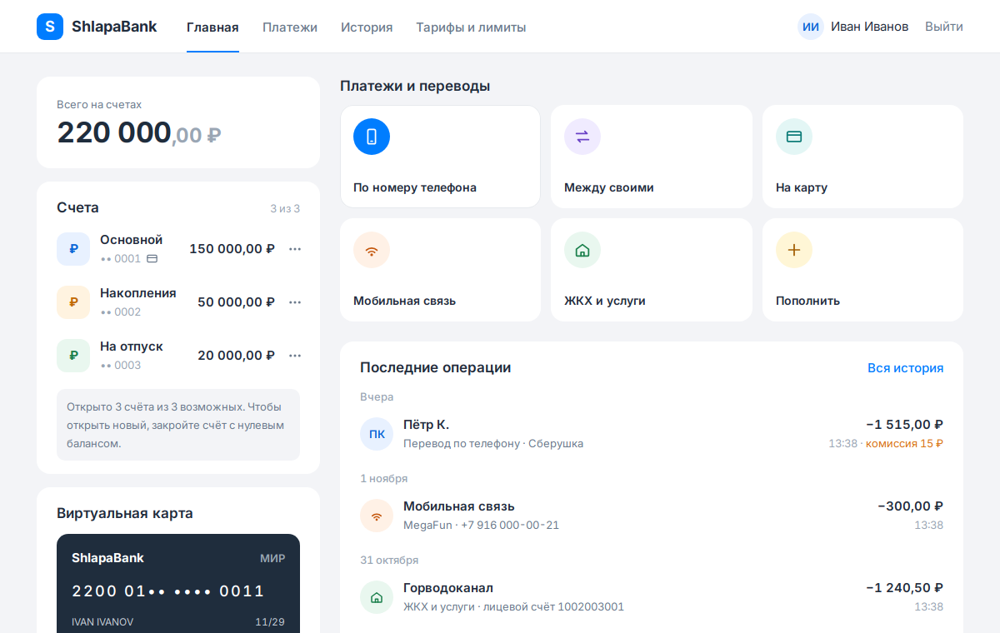

# ShlapaBank

Учебный интернет-банк для тренировки ручного тестирования и автотестов — UI, API и база данных.

**После запуска:**

| Что | Адрес |
| --- | --- |
| Документация: с чего начать, тестовые данные, требования | http://localhost:8090/ |
| Интернет-банк | http://localhost:8080/ |
| Swagger (API) | http://localhost:8080/docs |

Ссылки открываются только на вашем компьютере и только когда стенд запущен в Docker — как запустить, описано ниже.



## Что внутри

- регистрация и вход по коду из SMS;
- до 3 рублёвых счетов и виртуальная карта;
- переводы между своими, по телефону и на карту, оплата связи и ЖКХ, пополнение с карты другого банка;
- история операций, тарифы и лимиты;
- документация как в Confluence: тестовые данные, требования, ошибки API, страница с кодами из SMS;
- вспомогательные запросы для тестов: время банка (следующие сутки, плюс минуты), блокировки, сброс данных.

## Как запустить

Всё работает в Docker — ставить Python, Node.js или PostgreSQL не нужно.

1. Установите [Docker Desktop](https://www.docker.com/products/docker-desktop/) и запустите его. Дождитесь, пока он покажет, что Docker работает.
2. Скачайте проект:

   ```bash
   git clone https://github.com/abramovalera/shlapabank.git
   cd shlapabank
   ```

3. Поднимите стенд:

   ```bash
   docker compose up -d --build
   ```

   Первый запуск занимает несколько минут: скачиваются образы и собирается интерфейс.

4. Откройте документацию http://localhost:8090/ и начните со страницы «Как начать».

**Что поднимется:**

| Сервис | Порт | Что это |
| --- | --- | --- |
| `ui` | 8080 | интернет-банк и Swagger |
| `backend` | 8001 | сервер API |
| `db` | 5432 | PostgreSQL: база `shlapabank_app`, логин и пароль `shlapabank` / `shlapabank` |
| `docs` | 8090 | документация |

**Полезные команды:**

| Что | Команда |
| --- | --- |
| Остановить | `docker compose down` |
| Запустить снова | `docker compose up -d` |
| Что запущено | `docker compose ps` |
| Логи сервера | `docker compose logs -f backend` |
| Удалить всё вместе с базой | `docker compose down -v` |

## Если не работает

- **Страница не открывается** — проверьте, что Docker Desktop запущен и `docker compose ps` показывает 4 сервиса в состоянии `running`. Сразу после запуска подождите 10–20 секунд.
- **Порт занят** (`port is already allocated`) — на компьютере уже что-то работает на 8080, 8090, 8001 или 5432 (например, свой PostgreSQL). Остановите это или поменяйте порт слева в `docker-compose.yml`, например `"8081:80"`.
- **Данные испорчены** — верните исходные: `POST http://localhost:8080/api/v1/test/reset` (подробнее — в документации, раздел «Вспомогательные действия»).
