# Как начать

Сценарий: новый клиент пополняет счёт и переводит деньги клиенту ShlapaBank — через интерфейс и через API.

## Тест 1. Через интерфейс

**1. Регистрация.** Откройте http://localhost:8080/register и заполните:

| Поле | Значение |
| --- | --- |
| Имя | `Олег` |
| Фамилия | `Тестов` |
| Телефон | `9005550001` — или любой свободный: стенд общий, номер может быть занят |
| Пароль и повтор | `Start1234!` — нужны строчная и заглавная латинская буква, цифра и спецсимвол |

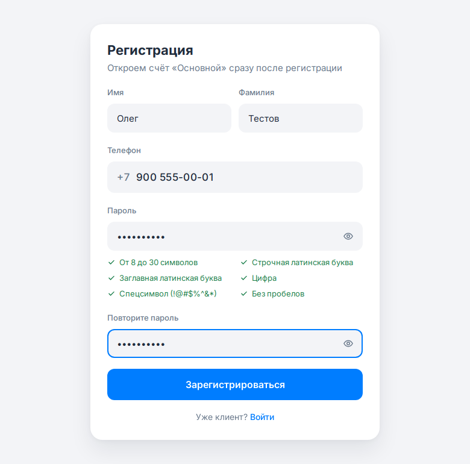

**2. Вход.** После регистрации откроется вход с подставленным телефоном. Введите пароль → **«Войти»**.

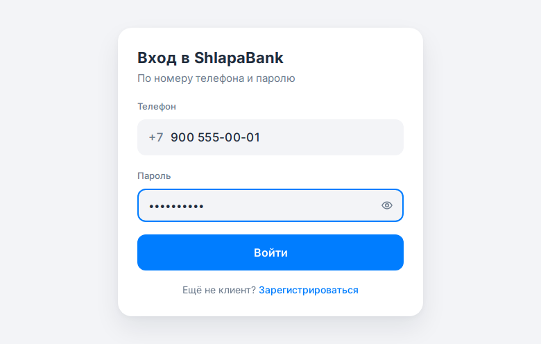

Появится экран кода из SMS:

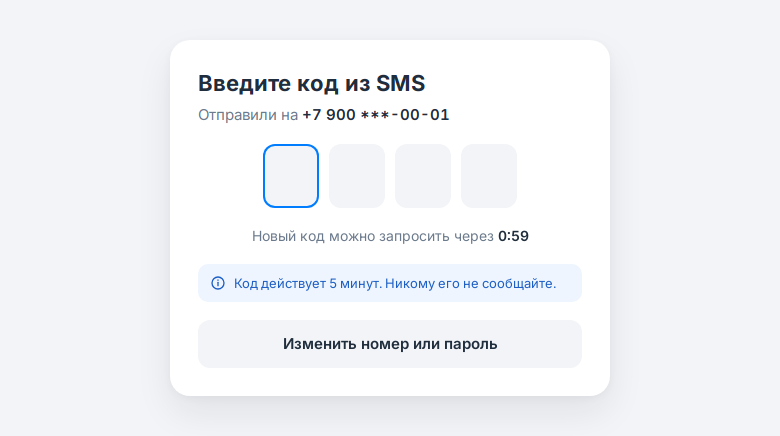

**Где взять код.** На стенде SMS на телефон не приходят. Откройте во второй вкладке страницу [SMS](tools/01-sms.html) и введите в поле свой телефон — сверху будет новая SMS с кодом. Нажмите на код, чтобы скопировать, и введите его — вход выполнится сам.

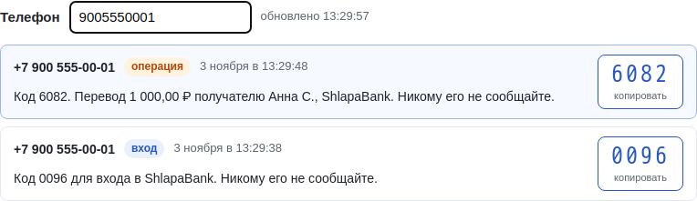

**3. Главная.** У нового клиента счёт «Основной» с балансом **0 ₽**.

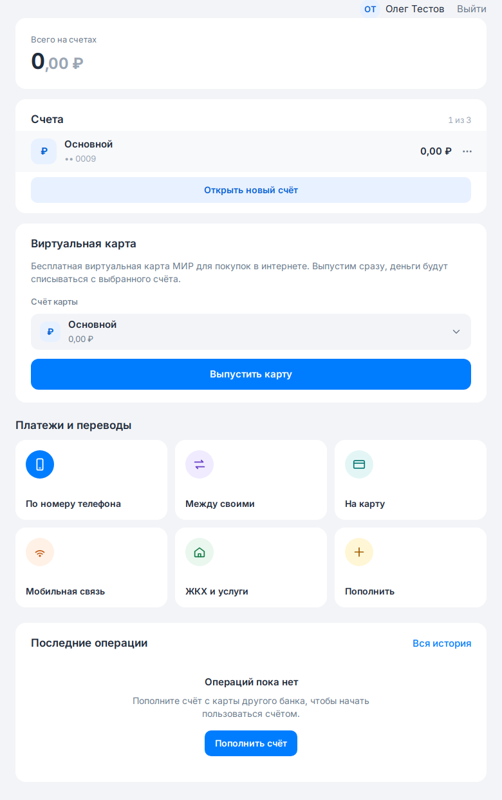

**4. Пополнение.** Плитка **«Пополнить»**, заполните и нажмите **«Пополнить»**:

| Поле | Значение |
| --- | --- |
| Номер карты | `4276000000001015` |
| Срок | `12/30` |
| CVC | `123` |
| Сумма | `5000` |

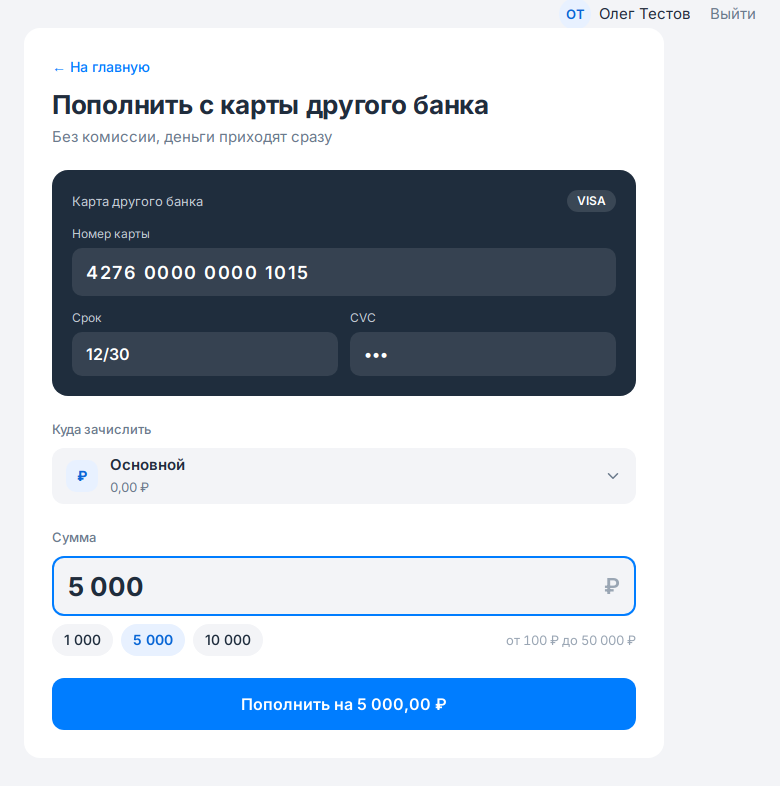

Ожидаемо: экран **«Счёт пополнен»**, на счёте **5 000 ₽**.

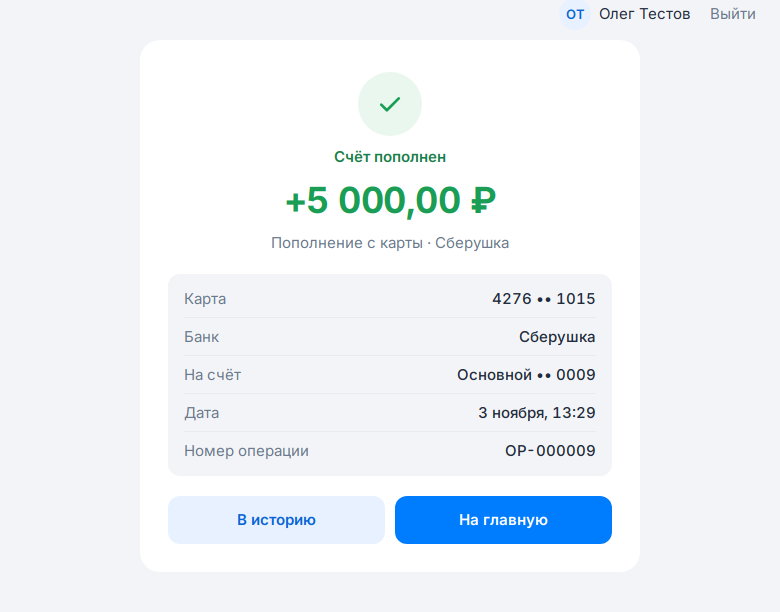

**5. Перевод.** Плитка **«По номеру телефона»**:

| Поле | Значение |
| --- | --- |
| Телефон получателя | `9000000001` — Анна С., ShlapaBank |
| Сумма | `1000` |

Комиссия — **бесплатно**, спишем **1 000 ₽**.

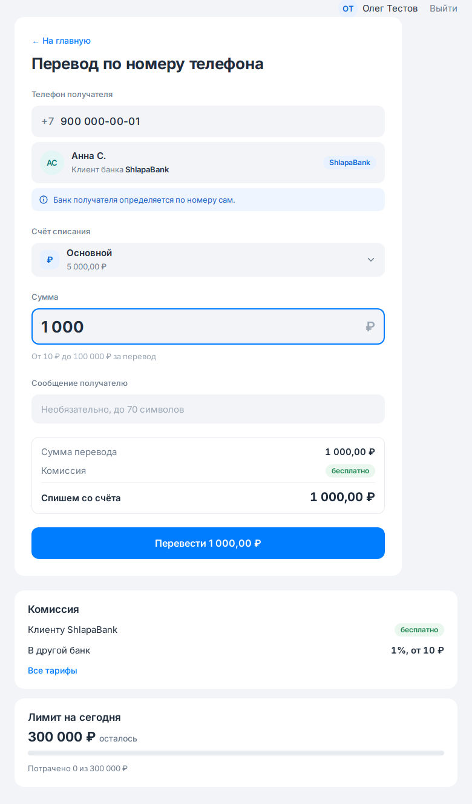

**«Перевести»** → появится окно кода. Код — на той же странице [SMS](tools/01-sms.html): сверху появится новая SMS с пометкой **«операция»** и текстом «Перевод 1 000,00 ₽ получателю Анна С., ShlapaBank».

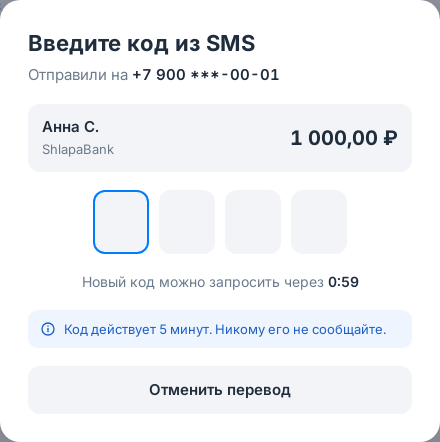

Ожидаемо: **«Перевод выполнен»**.

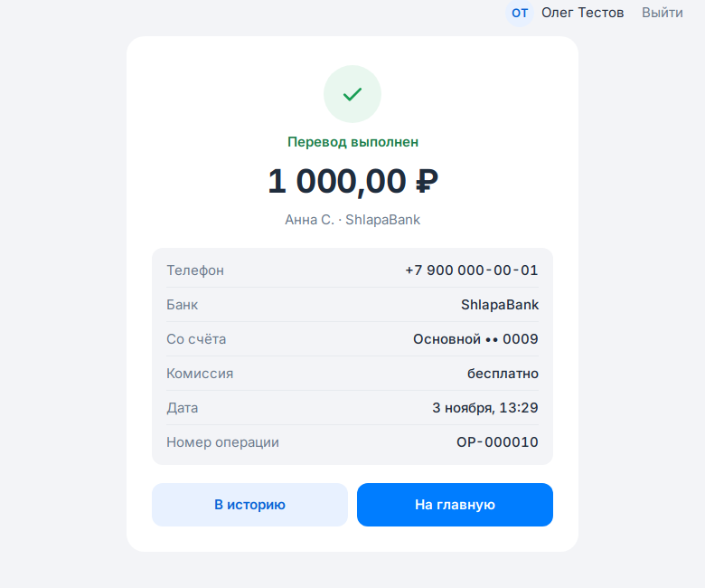

**6. История.** Две операции: перевод **−1 000 ₽** и пополнение **+5 000 ₽**; на счёте **4 000 ₽**.

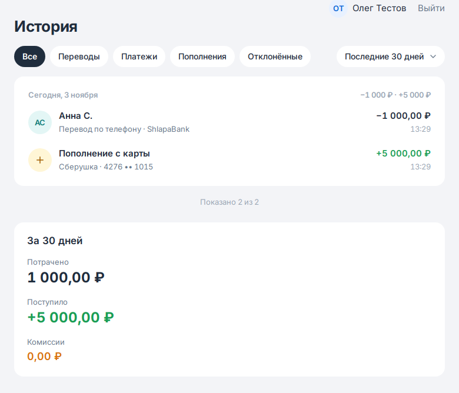

## Проверка в базе данных

Подключение в DBeaver или DataGrip:

| Параметр | Значение |
| --- | --- |
| Хост | `localhost` |
| Порт | `5432` |
| База | `shlapabank_app` |
| Логин | `shlapabank` |
| Пароль | `shlapabank` |

Без DBeaver — из консоли (из любой папки): `docker exec -it $(docker ps -qf name=shlapabank-db) psql -U shlapabank shlapabank_app`. В Git Bash на Windows вместо `-it` допишите в начало `winpty`, а для одного запроса подойдёт `docker exec $(docker ps -qf name=shlapabank-db) psql -U shlapabank shlapabank_app -c "select * from tariffs"`. Подойдёт и любой другой клиент PostgreSQL с параметрами из таблицы.


Баланс нового клиента:

```sql
SELECT a.number, a.name, a.balance
FROM accounts a JOIN users u ON u.id = a.user_id
WHERE u.phone = '+79005550001';
```

Ожидаемо: `4000.00`.

Операции клиента:

```sql
SELECT o.id, o.type, o.status, o.amount, o.fee, o.cp_name
FROM operations o JOIN users u ON u.id = o.user_id
WHERE u.phone = '+79005550001'
ORDER BY o.id;
```

Ожидаемо:

| type | status | amount | fee | cp_name |
| --- | --- | --- | --- | --- |
| `TOPUP` | `DONE` | `5000.00` | `0.00` | |
| `PHONE_TRANSFER` | `DONE` | `1000.00` | `0.00` | `Анна С.` |

У Анны (`+79000000001`) в `operations` появилась операция `INCOMING_TRANSFER` на `1000.00`.

## Тест 2. Через API

!!! note "Если сложно начать — вот готовая коллекция базового сценария"
    [ShlapaBank-start.postman_collection.json](files/ShlapaBank-start.postman_collection.json) — Postman → **Import** → выберите файл → у коллекции **Run**. Коллекция сама регистрирует нового клиента со случайным телефоном, берёт коды из SMS, сохраняет токен и проверяет результат — запускать можно сколько угодно раз.

Тот же сценарий запросами, с новым клиентом. Адреса — от `http://localhost:8080/api/v1`, поля запросов — в [Swagger](tools/02-swagger.html). После входа во всех запросах заголовок `Authorization: Bearer <access_token>`.

| Шаг | Запрос | Что передать | Ожидаемо |
| --- | --- | --- | --- |
| 0 | `POST /auth/register` | телефон, например `+79005550002`, пароль `Start1234!`, имя, фамилия | `201` |
| 1 | `POST /auth/login` | телефон и пароль | `200`, `challenge_id` |
| 2 | `GET /test/sms?phone=9005550002&limit=1` | — | `code` из SMS |
| 3 | `POST /auth/login/confirm` | `challenge_id`, `code` | `200`, `access_token` |
| 4 | `GET /accounts` | — | счёт «Основной», `balance` `0.00`, его `id` |
| 5 | `POST /operations/topup` | `to_account_id`, карта `4276000000001015`, срок `12/30`, CVC `123`, сумма `5000` | `201`, `status` `DONE` |
| 6 | `POST /operations/phone-transfer` | `from_account_id`, телефон `+79000000001`, сумма `1000` | `201`, `status` `WAITING_CODE`, `fee` `0.00`, `id` операции |
| 7 | `GET /test/sms?phone=9005550002&limit=1` | — | `code` для операции |
| 8 | `POST /operations/{id}/confirm` | `code` | `200`, `status` `DONE` |
| 9 | `GET /accounts` | — | `balance` `4000.00` |
| 10 | `GET /operations` | — | две операции, `status` `DONE` |

!!! warning "Стенд общий"
    Не сбрасывайте стенд (`POST /test/reset`), если с ним работает кто-то ещё — сброс удалит всех новых клиентов и их операции. Инструменты стенда — на странице [Вспомогательные действия](tools/03-test-api.html).
